# Super Robot Wars F & F Final: English Translation

A complete English translation of **Super Robot Wars F** (*Super Robot Taisen F*) and **Super Robot Wars F Final** (*Super Robot Taisen F Kanketsuhen*) for the PlayStation.

I treated the two games as one project, since F Final picks up exactly where F leaves off. Everything you read in either game is in English: the story, every battle quote, the menus, the encyclopedia, hero setup, and even the title screen. Along the way I fixed a long list of bugs that shipped in the original Japanese games, and I added a few things I always wanted when I played them, like a Battle Scene on/off switch, subtitles for the voiced scenes, and an experimental New Game+.

**Version 1.0** (build 80, 2026-10-25). This is the final release; builds 79 and 80 are small hotfixes on top of the first release (build 78), listed in the Changelog. There are four patches: one for each game, plus an **experimental** New Game+ version of each.

> **Start a new save.** Don't load a save from the Japanese games. The patch shows names in an English font, so a Japanese save's hero and partner names come out as garbage. Begin a fresh game on the patched disc, and carry that save from F into F Final.

---

## Bugs from the original games that I left alone

A few quirks stay as they are. Some would mean changing how the game reads the disc, and I won't touch that. The rest are how the original games were made. The Japanese releases do the same in every case below.

- **Wrong portrait:** if a character's portrait fails to load from the disc, the game keeps showing the last face it drew, so a line can show the wrong character's face.
- **Black screen after battles:** going back to the map after a battle takes about 6 seconds of black screen while the game reloads from the disc.
- **Noriko and Guts (F Final):** on the ground routes, Noriko never learns Guts, because the game only gives it to her in a space route stage. She still learns Super Guts.
- **Master Asia and Allenby never parry (F Final):** both have the Parry skill, but Master Gundam and Nobel Gundam have no sword-type weapon, so it never triggers.
- **Big Zam (F Final, DC route):** Sleggar's charge still destroys Big Zam when it has 1,999 HP or less. That's the scripted event. I only fixed the screen trouble that came with it.
- **Memory card space:** the first save needs at least 3 free blocks on the card. With fewer, the game says the card is full.
- **Saturn-only reports:** two freezes listed online for SRW F (Heavyarms next to Boss Borot, and a quick-save Continue against Dr. Hell) come from the Saturn version. They don't happen on the PlayStation.

Thanks to haman on [retrogametalk.com](https://www.retrogametalk.com) for bringing the portrait one to my attention, so I can let you know what to expect.

---

## Screenshots

<table>
<tr><td width="50%">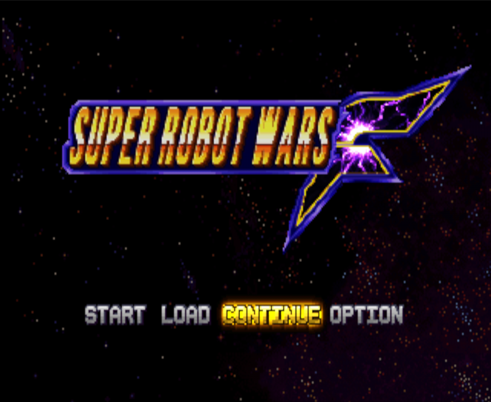<br><sub>SRW F title screen</sub></td><td width="50%">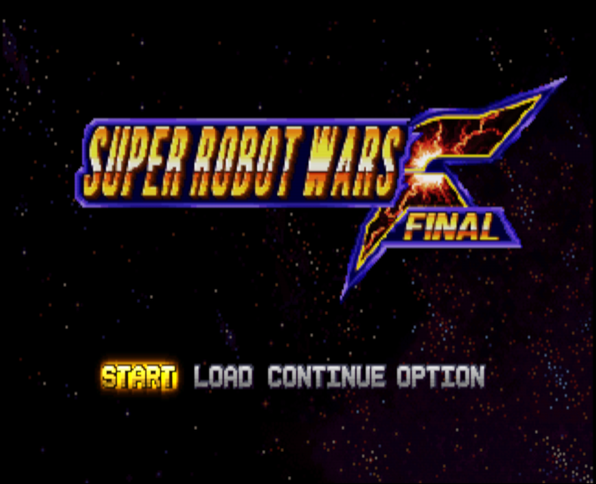<br><sub>F Final title screen</sub></td></tr>
<tr><td width="50%">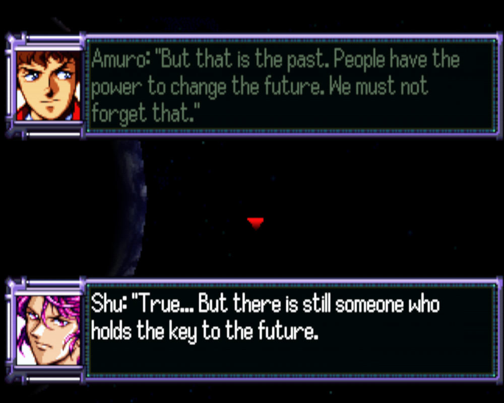<br><sub>Story dialogue</sub></td><td width="50%">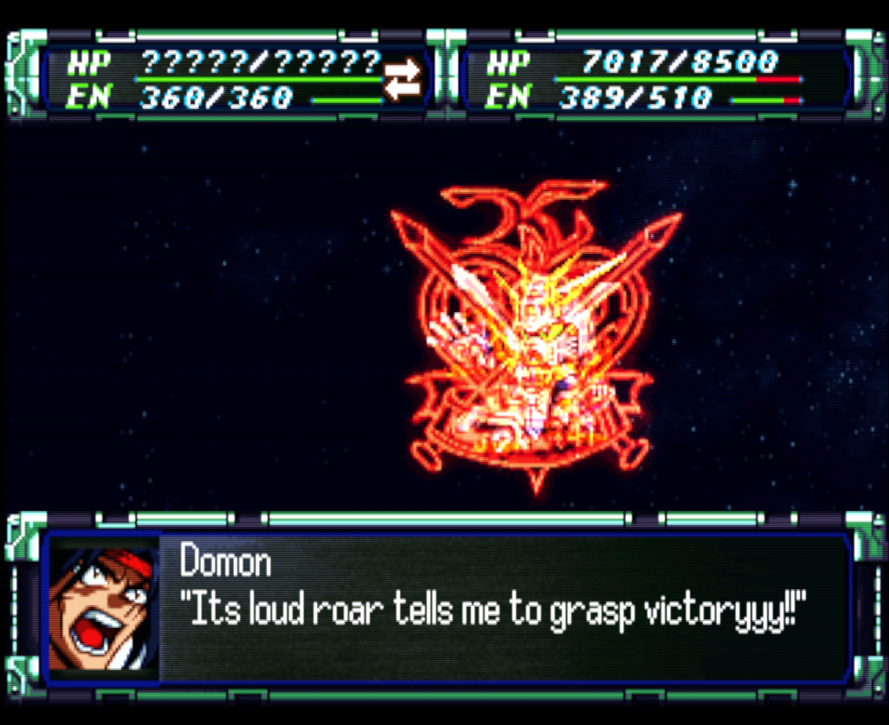<br><sub>Battle scene quote</sub></td></tr>
<tr><td width="50%">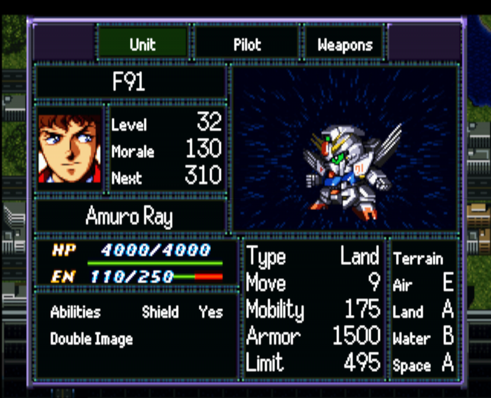<br><sub>Unit status</sub></td><td width="50%">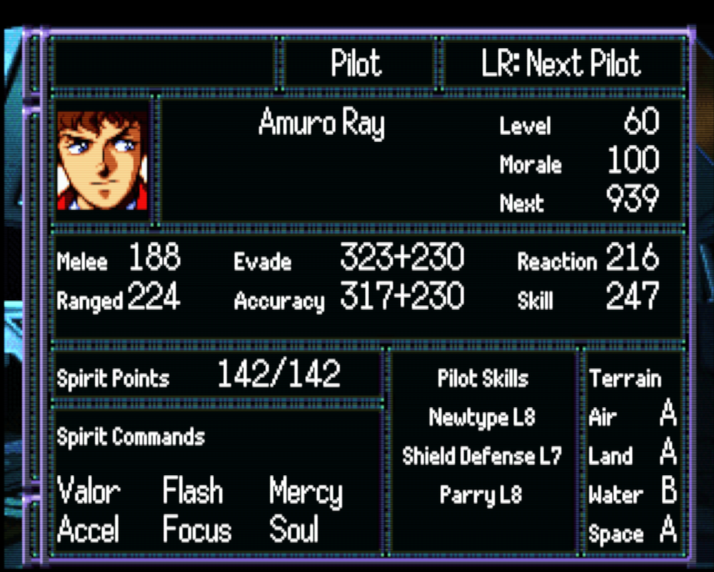<br><sub>Pilot status</sub></td></tr>
<tr><td width="50%">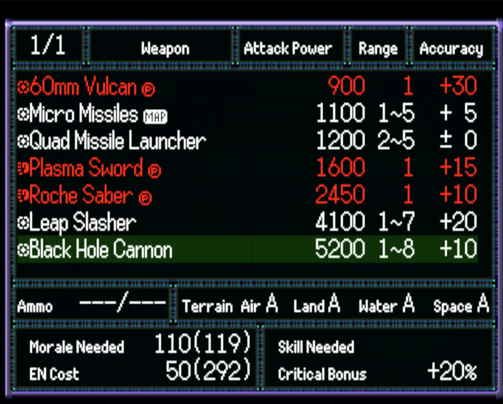<br><sub>Weapon list</sub></td><td width="50%">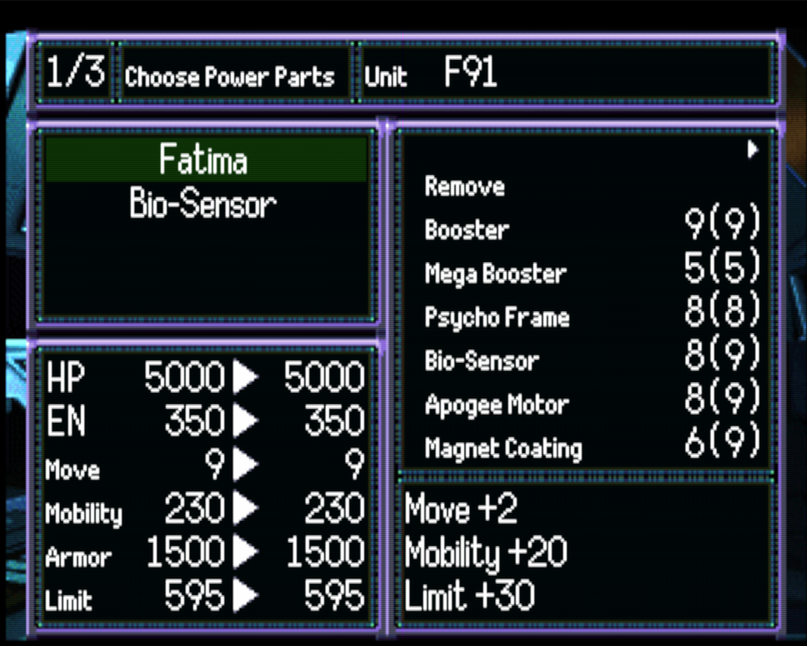<br><sub>Power Parts</sub></td></tr>
<tr><td width="50%">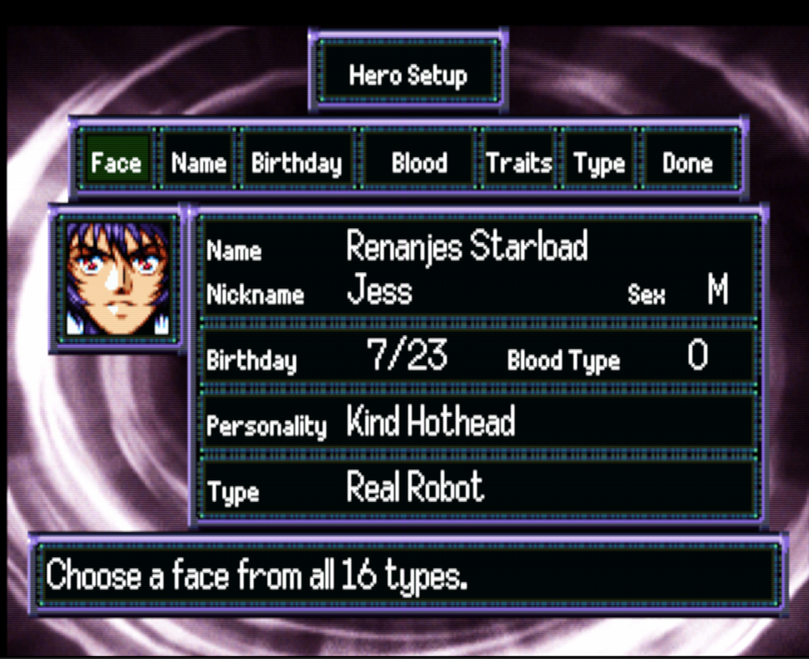<br><sub>Hero setup</sub></td><td width="50%">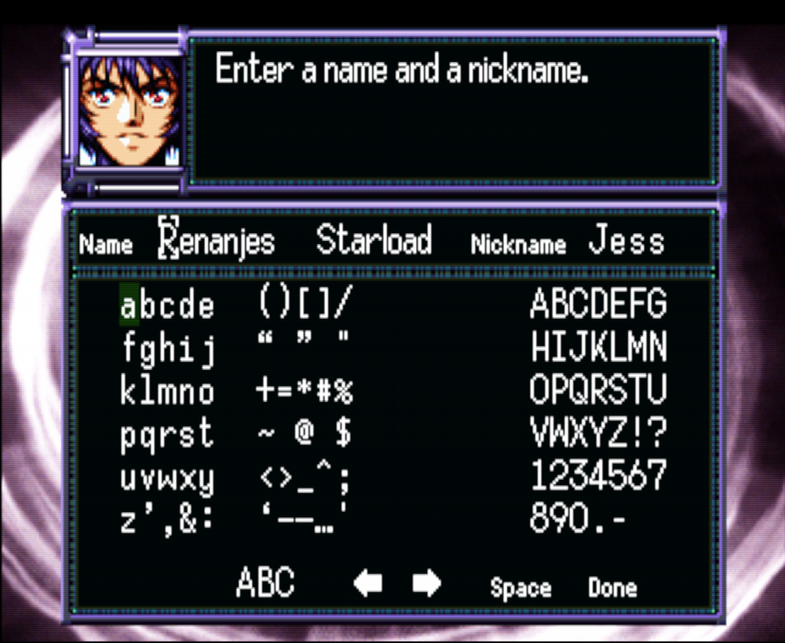<br><sub>Name entry</sub></td></tr>
<tr><td width="50%">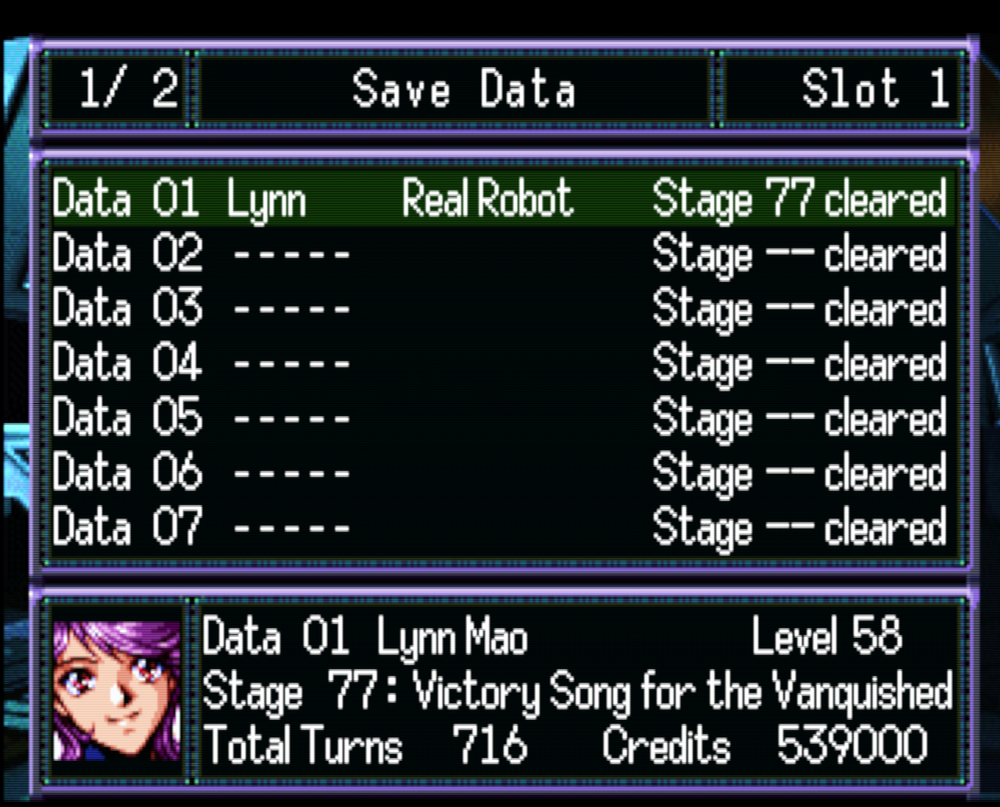<br><sub>Save data</sub></td><td width="50%"></td></tr>
</table>

---

## Downloads

| Patch | Game | File |
|---|---|---|
| English | Super Robot Wars F | [`patches/SRW_F_English.xdelta`](patches/SRW_F_English.xdelta) |
| English | Super Robot Wars F Final | [`patches/SRW_F_Final_English.xdelta`](patches/SRW_F_Final_English.xdelta) |
| English + New Game+ (**EXPERIMENTAL**) | Super Robot Wars F | [`patches/ngplus-experimental/SRW_F_English_NGplus_EXPERIMENTAL.xdelta`](patches/ngplus-experimental/SRW_F_English_NGplus_EXPERIMENTAL.xdelta) |
| English + New Game+ (**EXPERIMENTAL**) | Super Robot Wars F Final | [`patches/ngplus-experimental/SRW_F_Final_English_NGplus_EXPERIMENTAL.xdelta`](patches/ngplus-experimental/SRW_F_Final_English_NGplus_EXPERIMENTAL.xdelta) |

Pick **one** set and use it for **both** games: either the two plain patches, or the two New Game+ patches. Don't mix them.

> **Plain or New Game+?** The plain patches are frozen: they won't be updated unless a serious bug turns up, and they're the safe version to play. New Game+ is experimental and still gets fixes; for example, before Update 79 it did not carry Mobility upgrades. If you play New Game+, always use the latest New Game+ patches from this page and patch both games with them. A run started on an older patch keeps what that patch carried.

---

## How to patch

You need the Japanese Redump dumps. Each patch goes on **Track 1** only. Track 2 (the CD audio) is used as it is.

| Game | Original Track 1 | MD5 of the original |
|---|---|---|
| Super Robot Wars F | `Super Robot Taisen F (Japan) (Track 1).bin` | `f064a3cccce3d7fe8a1163bc58e8fbf4` |
| Super Robot Wars F Final | `Super Robot Taisen F - Kanketsu-hen (Japan) (Track 1).bin` (older sets: `Super Robot Taisen F Kanketsuhen (Japan) (Track 1).bin`) | `bbdd2cdbc756513bf3d11e68cb7df4ff` |

1. Check that your Track 1 has the MD5 above. If it doesn't, the patch won't apply.
2. Apply the `.xdelta` to Track 1 with any xdelta3 patcher. From a command line:
   ```
   xdelta3 -d -s "Super Robot Taisen F (Japan) (Track 1).bin" SRW_F_English.xdelta "Super Robot Wars F (English) (Track 1).bin"
   ```
3. Check the patched Track 1 against the MD5 below.
4. Make a `.cue` next to it that points at the new Track 1 and your original Track 2:
   ```
   FILE "Super Robot Wars F (English) (Track 1).bin" BINARY
     TRACK 01 MODE2/2352
       INDEX 01 00:00:00
   FILE "Super Robot Taisen F (Japan) (Track 2).bin" BINARY
     TRACK 02 AUDIO
       INDEX 00 00:00:00
       INDEX 01 00:02:00
   ```
5. Open the `.cue` and **start a new game**. Don't load a Japanese save: the hero and partner names would show as garbage.

| Patched Track 1 | MD5 |
|---|---|
| Super Robot Wars F (English) | `b6443c1e7af87ec7fe7973ae6df8f726` |
| Super Robot Wars F Final (English) | `0ebe9afdcc552fa9fad4837083088b67` |
| Super Robot Wars F (English + NG+, experimental) | `20e719eb7b0f89243ba99686ce04b7d2` |
| Super Robot Wars F Final (English + NG+, experimental) | `a7102bbc453867af68f88e0e88cdcd94` |

Your original files are never changed. The patch writes a new file.

### If the game won't boot: the .cue file

Most boot problems come from the `.cue` file, not the patch.

**The easy fix.** Make a new folder. Copy your original Track 2 `.bin` and your original `.cue` into it. Put the patched Track 1 in the same folder and give it **exactly** the original Track 1's file name. The original `.cue` then works as it is.

**Or write the .cue yourself.** Open Notepad, paste the sheet for your game below, and change the Track 1 line to your patched file's name. Choose *Save As*, set *Save as type* to **All Files**, and name it something like `Super Robot Wars F (English).cue`, so it doesn't become `.cue.txt`. Keep it in the same folder as both `.bin` files.

Super Robot Wars F (Redump disc 27769):
```
FILE "Super Robot Taisen F (Japan) (Track 1).bin" BINARY
  TRACK 01 MODE2/2352
    INDEX 01 00:00:00
FILE "Super Robot Taisen F (Japan) (Track 2).bin" BINARY
  TRACK 02 AUDIO
    INDEX 00 00:00:00
    INDEX 01 00:02:00
```

Super Robot Wars F Final (Redump disc 2682):
```
FILE "Super Robot Taisen F - Kanketsu-hen (Japan) (Track 1).bin" BINARY
  TRACK 01 MODE2/2352
    INDEX 01 00:00:00
FILE "Super Robot Taisen F - Kanketsu-hen (Japan) (Track 2).bin" BINARY
  TRACK 02 AUDIO
    INDEX 00 00:00:00
    INDEX 01 00:02:00
```

If your files use the older name `Super Robot Taisen F Kanketsuhen (Japan)`, write that instead. Every name in the `.cue` must match the file on disk letter for letter.

**Open the `.cue`, not the `.bin`,** in your emulator (in DuckStation: *Start File* and pick the `.cue`). Opening the `.bin` alone loses the CD audio track.

**Turn off DuckStation's texture cache.** In *Settings > Graphics > Texture Replacement*, untick *Enable Texture Cache*. With it on, SRW F's opening crawl can stay blank for about 45 seconds and then start partway through. The untouched Japanese disc does the same, so this is an emulator setting, not the patch.

---

## What I translated

All of it. Nothing is left in Japanese that a player reads.

- **Story:** every line of story dialogue in both games, across every route, scenario branch and ending, with each speaker's voice kept consistent from F into F Final.
- **Battle quotes:** every attack, dodge, hit, barrier and counter line, re-read against the exact moment it plays and who is saying it.
- **Menus and screens:** Intermission, unit and pilot pages, weapons, upgrades, Power Parts, Spirit commands, pilot skills, Counter Orders, unit lists, the map menus, save and load, memory card messages, system and button settings, and every confirm box.
- **Hero setup:** name entry, personalities, birthdays, blood types and the hero and partner descriptions.
- **Character Encyclopedia:** every entry.
- **Objectives:** every stage's victory and defeat conditions.
- **Graphics:** stage title and robot name banners, the staff credits, the F Final epilogue images, and the title screen logo and buttons, all redrawn in English at the original image sizes and in the original style.
- **Karaoke Mode:** every song's lyrics in romaji, centred on screen, with the highlight retimed letter by letter so it still follows the singing.
- **Names:** official English spellings for every series, character, robot and attack. See the note on names below.

### A note on names

Some character and robot names may not match the English localizations you know from later games. That's a deliberate choice, not a mistake. For the Banpresto original characters and robots I used Banpresto's own official spellings from *Super Robot Wars Scramble Gather*, for example Masaki Ando, Tutty Norback, Cybaster, Granvale and Nols Ray. Names from the licensed series use their official English spellings, and I didn't rename anyone to match an English dub.

---

## Bugs from the original games that I fixed

These bugs are in the Japanese releases. Each one is fixed in a way that keeps the game's designed outcome. I fixed the bug, not the story.

**Both games**
- Critical hit bonuses now work as the weapon list shows them. Weapons marked "-20" were secretly getting +20.
- Parry L9 and Shield Defense L9 now actually work at level 9.
- When Super Gundam is shot down, Gundam Mk-II no longer takes Super Gundam's upgrades and parts.
- No more EXP for a counterattack that never happened when Re-GZ, Super Gundam or GP03 Dendrobium is shot down.
- The transfer menu no longer hides every empty unit from one pilot (seen with Iino after F stage 27).
- Units no longer pick up Sea A and an HP upgrade at the end of some maps (seen on Boss Borot and GP03 Dendrobium).

**Super Robot Wars F Final**
- Gundam Heavyarms Custom's Full Barrage can be bought.
- Eva Unit-01 going berserk during a MAP attack no longer doubles your funds and EXP or corrupts your parts.
- With Sleggar in Super Gundam, the Big Zam event no longer blacks out the screen, and Big Zam's destruction no longer scrambles it.
- Eva Unit-03 no longer overwrites your saved button settings in stage 69.
- Wing Zero Custom no longer copies another Gundam's upgrades or shares its parts, and no longer shows up early without its upgrades.
- When Daba persuades Asphy to join you in stage 60, her four unmanned Bat-Shu now leave the map instead of staying behind as neutral units that keep fighting.
- The Gundam W pilots board their own Gundams.
- Birgit keeps his Jegan.
- The-O appears once, not twice.
- Gavlet's Spirit commands come right after Daba's MAP attack, as intended.
- Buying a bonus weapon no longer adds an 11th upgrade.
- Wufei can sortie again after another pilot takes the Altron Gundam.
- The enemy Novel D-Sserd no longer gets the Buster Launcher you gave yours.
- Granzon's Black Hole Cluster no longer reads past its data, which corrupted the screen and then froze the game.
- In stage 171, the map effects no longer turn to garbage after the Getter Robo combination movie.
- In stage 137, Ritsuko's and Misato's portraits no longer turn white after the Eva refit menus.
- Shapiro's revival line in stage 67B, garbled in the Japanese game, now shows correctly.
- Two lines where the Japanese script itself had a mistake (a name mix-up, and the time on the Axis device) are corrected.

---

## What I added

- **Battle Scene ON/OFF.** Modern SRW style. On the battle forecast (and on the response menu when the enemy attacks), pick "Battle Scene" to flip it, then "Begin Battle". With it OFF, the fight plays out right on the map: damage pop-ups on both units, MISS when a shot misses, CRITICAL, barrier, shield and Defend effects, and the counterattack. With it ON you get the full animation. Story battles that the script orders always play their full scene.
- **Skip battle animations with X.** During a battle scene, press Cross (X, the Cancel button; you can change it in Button Settings) to end the animation at once and cut off the voice line. The result is the same as watching it through. If a voice clip is still loading, the skip waits a moment for it, which is what keeps it from freezing. Story battles can't be skipped.
- **Longer hero names.** The hero's and partner's first name and surname can be up to 7 letters each, and the nickname up to 6 (the original allowed 6, 6 and 5). The name entry box is wider to match, and every story line that uses a name is laid out for the longest names you can type.
- **Subtitles for voiced scenes.** The in-engine voiced cutscenes that have no text box (Master Asia's arrival, for one) now have English subtitles, centred under the picture.
- **Subtitles for the anime movies.** Every movie with spoken Japanese is subtitled on the black bar under the picture: 6 in F and 5 in F Final. Movies with only music stay as they were.
- **Subtitles for map attack voices.** In F Final, the pilot lines voiced during map weapon attacks (High Mega Cannon, Twin Buster Rifle, Fin Funnels, Ideon Gun and Ideon Sword, and the rest) show as subtitles at the bottom of the map, in the same style as the battle scenes. Master Asia's map shout gets its "Explode!" in both games.
- **Long voiced lines page properly.** When a voiced story line needs a second text box, the second box comes up on its own at the pause in the voice where that sentence ends, the way the Japanese game times its own long voiced lines.
- **Battles load as fast as the Japanese disc.** The patched files keep the original disc layout, so there is no extra seek time before or after battle scenes.
- **New Game+ (EXPERIMENTAL, separate patches).** Start SRW F over with what you built up in F Final. See [How to start New Game+](#how-to-start-new-game) below.

### How to start New Game+

This needs the two New Game+ patches, for both games.

1. Play F Final on the New Game+ patch to the end. A Japanese save, or one from the plain patch, won't start New Game+.
2. After the credits, a Save screen opens. Save there. That's your clear save.
3. Put the clear save on the same memory card you play SRW F from, with at least one free block left.
4. Start SRW F (New Game+ patch), choose **Load** on the title screen, and pick the F Final clear save. It's offered in a slot where SRW F has no save of its own.
5. A new SRW F game starts at hero setup.

What carries over: your **unit upgrades, money and Power Parts**. Parts come back unequipped and in stock, within the game's own limits of 9,999,999 credits and 9 of each part. Upgrades follow each unit back down its line to its first form (Shin Getter's upgrades go to Getter Robo, for example), and the upgrade limit is 10 from the start. Pilot levels and everything else start fresh. The run carries on into F Final as usual.

Good to know:
- **Always use the latest New Game+ patch.** New Game+ is experimental and still gets fixes; for example, before Update 79 it did not carry Mobility upgrades. Before you start a run, check this page for the newest New Game+ patches and patch both games with them. A run started on an older patch keeps what that patch carried. The regular patches (without New Game+) are final and will only change if a serious bug turns up; they are the safe version to play.
- A clear save from a New Game+ run never starts another one.
- New Game+ writes one small file per run to the memory card, named **SRW F NG+ UPGRADES**. Keep it, and keep it on the same card as that run's saves; without it, the run's units join without their upgrades.
- If the card is full, the Load says the data can't be loaded and nothing changes.
- **Three story events delete a robot, upgrades and all.** In F Final, when Sleggar sacrifices himself at the Big Zam battle, when Four dies protecting Kamille, and when Quattro goes missing at A Baoa Qu, the game deletes the robot that pilot is sitting in at that moment. The original game does this too. New Game+ copies what's in your clear save, so a robot lost this way starts the next run without its upgrades. If you want to keep a robot's upgrades, don't have these pilots in it when those battles come. (Kamille leaving doesn't cost you the Zeta Gundam; it stays.)
- **Wong's offer to take your unused machines also costs you robots.** In F Final, after the battle with Drake's army, Wong offers to buy the machines you no longer need, and you get 100,000 for them. At that point the game moves some pilots out of the mobile suits they were in, and every robot left without a pilot is thrown away, upgrades and all. Those robots won't carry over to New Game+ either. Before that scene, put a pilot in every robot whose upgrades you want to keep.

---

## No shortcuts

This was the rule I held myself to on every screen, and it's the part of this project I'm proudest of.

- **No shortened text.** Every line says everything the Japanese says. When English ran longer than the box, I made room. I never cut the line.
- **No ugly abbreviations.** No "Atk", "Splt", "Supl" or "Trnsfrm". Commands, skills, spirits, weapons and terrain names are spelled out in full, even the long ones like "Daisetsuzan Oroshi Nidan-Gaeshi" and "Photonic Energy Research Institute". The only abbreviations are ones the original already used, like V.S.B.R., and those keep their official form.
- **No proportional squeezing.** I never crammed letters together to make a line fit. Windows were widened or moved, lines were re-wrapped, and a line that is too long for one box carries over to the next box at a natural break (a sentence end, or between words), never mid-thought, just like the Japanese game's own continuation boxes.
- **The game's own look.** Every window uses the game's own frame. Names and labels are centred where the original centres them. Each line uses one font size, never a mix of big and small. Redrawn graphics match the original size byte for byte and keep the original colours, shading and style.
- **The engine stays the game's own.** The English text lives in its own block next to the original data instead of being crammed into the Japanese text space, and the game's code is left alone apart from the few hooks the new features need.

---

## Playtest scope

I completed a playthrough manually, all the way to the final stages of the **Guest-Posaydal route**. I skipped the **Space route**, the **DC route** and the **Eva bad end**, because I do not have time to playtest them.

The text on those routes is translated and checked the same way as the rest, but I haven't played through them myself. If something looks wrong there, please report it (see below).

New Game+ is **experimental**. I have not tested it in a real playthrough.

---

## Risks and known limits

- **Untested routes.** See the playtest scope above. The Space route, the DC route and the Eva bad end have not been played through.
- **New Game+ is experimental.** It reads and writes your memory card. Back up your memory card before you use it. Keep the SRW F NG+ UPGRADES file on the same card as that run's saves.
- **Start a new save.** Japanese saves load, but the hero and partner names show as garbage. Start fresh on the patched disc, and carry that save from F into F Final.
- **Emulator save states don't carry over.** States made on the Japanese disc or on an older build of this patch won't work. Load your memory card save instead.
- **Use matching patches.** Patch both games from the same set (both plain or both New Game+) so your F save carries into F Final cleanly.
- **Cheat codes.** Codes written for the Japanese release may not behave the same, because some of the game's data has moved.
- **Tested on DuckStation only.** That's where I played. Real hardware, optical drive emulators and other emulators haven't been tested.
- **Keep the disc as it is.** Don't rebuild the patched image or rearrange its files into folders. The map subtitles rely on the disc's original single-folder layout, and a rearranged disc breaks them.
- **Redump dumps only.** The patches apply only to the exact Redump Track 1 files listed above.

---

## Changelog

**v1.0 hotfix** (build 80, 2026-10-25): a cosmetic fix in all four patches (plain and New Game+).
- Added the missing space in "(Up to 10 levels)" on the unit upgrade screen, in both games. Before, it read "(Up to10 levels)".
- Nothing else changed.

**v1.0 New Game+ hotfix** (build 79, 2026-10-23): New Game+ patches only.
- New Game+ now carries Mobility upgrades too. Before this, they were left behind.
- The plain patches are unchanged.

**v1.0** (build 78, 2026-10-22): the first public release.
- The complete translation of both games, with every fix and addition listed above.
- The last changes before release: story lines re-read in context across every scene of both games, Queen Elle's name box reads "Elle Humm" so she isn't confused with Elle Vianno, and New Game+ now carries money and Power Parts as well as upgrades.

---

## Bug reports and credit

Credit: **redditusernameunavailable** on Discord.

Found a bug, a typo or a line that reads wrong? Send it to **redditusernameunavailable** on Discord. A screenshot and the stage number help a lot.

*Super Robot Wars* is a trademark of Bandai Namco. This is an unofficial fan translation. It contains no game data; you need your own copy of the original games.
